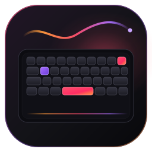
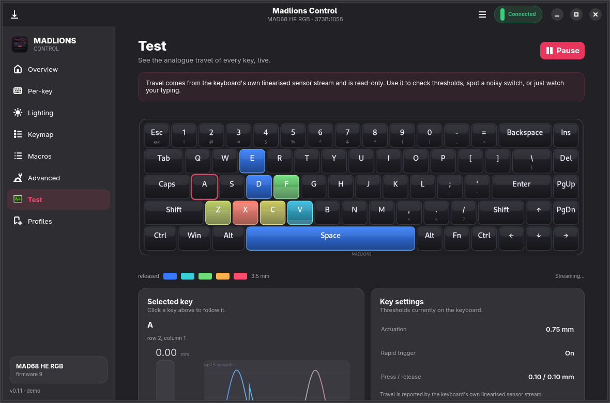
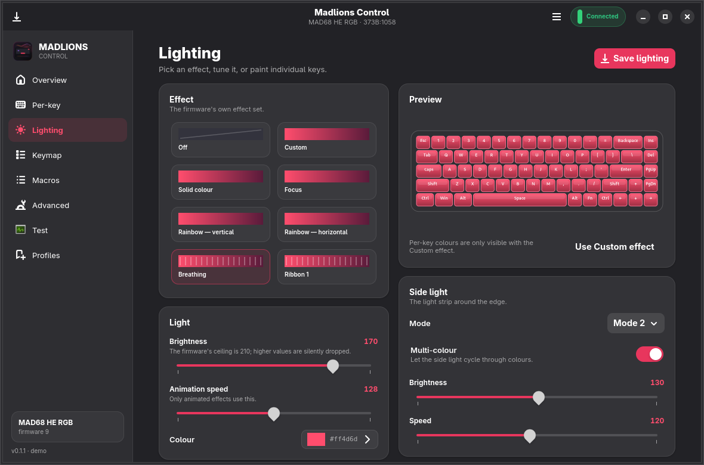
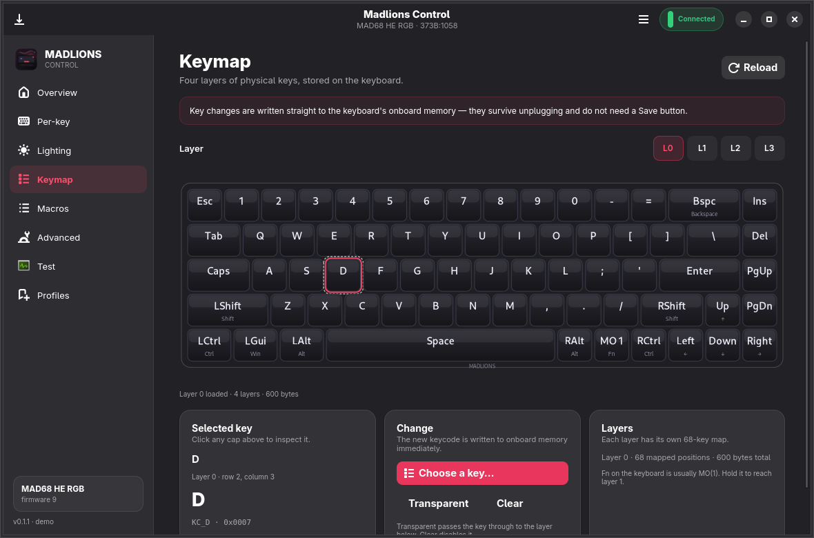
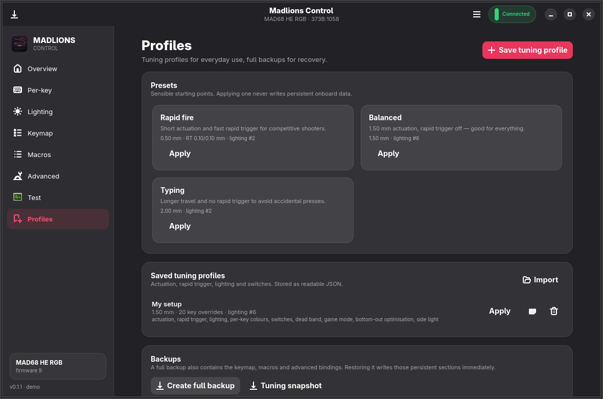

# Madlions Control

<p align="center">
  
</p>

<p align="center">
  <b>A native Linux app for MADLIONS Hall-effect keyboards.</b><br>
  Per-key actuation, rapid trigger, lighting, keymaps, macros and a live analogue test —
  without a browser tab, a vendor service or an account.
</p>

<p align="center">
  <a href="https://github.com/NasirA1991/madlions-control/actions/workflows/ci.yml"></a>
  <a href="https://github.com/NasirA1991/madlions-control/releases"></a>
  <a href="https://aur.archlinux.org/packages/madlions-control"></a>
  <a href="https://aur.archlinux.org/packages/madlions-control-git"></a>
  <a href="LICENSE"></a>
</p>


## Why

The official MADLIONS configurator is a WebHID page that only runs in Chromium,
needs a browser tab open, and treats Linux as an afterthought. Madlions Control
talks to the keyboard's own HID interface directly. It is a small GTK4 /
libadwaita application that starts instantly, works offline, and looks like it
belongs on your desktop.

It is built around the thing these keyboards are actually for: **adjusting the
feel of every single key**.

## Features

### Per-key hall-effect tuning

- Actuation point from **0.05 mm to 3.40 mm** in 0.01 mm steps.
- Rapid trigger per key, with separate **press** and **release** sensitivity.
- Multi-select keys with Ctrl-click, or select the whole board at once.
- Colour heat map shows the actuation value of every cap.
- Changes apply live; **Save to keyboard** is the only thing that writes flash.


### Live analogue test

- Real per-key travel from the keyboard's linearised sensor stream.
- Full-board heat map, selected-key gauge, threshold line and a rolling five-second graph.
- A real measurement tool: spot a noisy switch, check a threshold, or just watch
  your typing.



### Lighting

- Every effect the firmware supports, including breathing, ribbons, rotating
  belts, spectrum, digital rain and fingertip rainbow.
- Brightness, speed, colour, and per-key RGB painting.



### Keymap, macros and advanced keys

- Four onboard layers with a searchable keycode picker.
- Macro editor with taps, presses, releases, delays and typed text.
- Rapid snappy, SOCD, OKS, hold/click and dynamic keystroke (DKS) bindings.
- NKRO, Windows-key lock, WASD/arrow swap, macOS layout, game mode, bottom-out
  optimisation and dead-band controls.



### Profiles and everyday conveniences

- Save tuning profiles for everyday switching, or a full restorable backup in one click.
- Ready-made **Rapid fire**, **Balanced** and **Typing** presets.
- Export, import and automatic tuning snapshots as readable JSON. Full backups
  also capture the keymap, macros and advanced bindings.
- Command line (`madlionsctl`) for scripts, keybinds and status bars.
- Demo mode (`--demo`) to explore the app without a keyboard.
- No tray daemon, no background service, no account, no telemetry.



## Supported keyboards

**Tested by this project:** MADLIONS **MAD68 HE RGB** (`373B:1058`), firmware
protocol 9. Everything described above was exercised against physical hardware.

The same 32-byte MADLIONS/FGG controller is used by a large family. `1058` is
verified here, and `1053` (MAD60 HE) is enabled from community hardware testing.
Other boards are recognised but stay read-only until a device report confirms
the firmware and layout.

| Family | USB product IDs |
|---|---|
| MAD68 / FIRE68 / Z68 / MAG68 (65 %) | `1057` `1058` `1059` `105A` `10A3` `10A4` `10A7` `10A9` `10AA` `10AB` `10D6` `1123` `1136` `1139` `1144` |
| MAD60 / MAD63 / Z60 / MAD Light 60 (60 %) | `1053` `1054` `1055` `1056` `105D` `10AD` `10F6` `110B` `1120` `112A` |
| MAD Smart | `107D` |

A MADLIONS board with an unknown product ID is still detected if it exposes the
same 32-byte vendor collection. It is shown with a generic 5 × 15 layout and is
read-only, so you can inspect it safely. If you have one of these boards, a
[device report](https://github.com/NasirA1991/madlions-control/issues/new?template=device-report.yml)
helps add it properly.

## Install

Every release includes an AppImage, a Flatpak bundle and the source tarball. The AUR packages are available separately.

### Arch, CachyOS, EndeavourOS (AUR)

```bash
paru -S madlions-control       # latest tagged release
paru -S madlions-control-git   # latest main, rebuilt on updates
```

The packages install the application, the desktop entry, the icon and the udev
rule.

### Flatpak

Download `madlions-control-<version>-x86_64.flatpak` from the
[Releases page](https://github.com/NasirA1991/madlions-control/releases):

```bash
flatpak install --user ./madlions-control-0.1.1-x86_64.flatpak
flatpak run io.github.madlionscontrol.MadlionsControl
```

The Flatpak uses the GNOME runtime and needs broad raw-device access
(`--device=all`) because Flatpak cannot narrow access to one `/dev/hidraw` node
today. That is a real sandbox trade-off; the app only opens the vendor HID
collection. If the keyboard is not detected, install the udev rule below and
replug it.

### AppImage

```bash
chmod +x madlions-control-0.1.1-x86_64.AppImage
./madlions-control-0.1.1-x86_64.AppImage
```

The AppImage uses the host's Python and GTK stack. Install it with:

```bash
# Arch / CachyOS
sudo pacman -S python-gobject gtk4 libadwaita python-cairo hicolor-icon-theme
# Debian / Ubuntu
sudo apt install python3-gi gir1.2-gtk-4.0 gir1.2-adw-1 python3-cairo hicolor-icon-theme
# Fedora
sudo dnf install python3-gobject gtk4 libadwaita python3-cairo hicolor-icon-theme
```

The Flatpak bundles the app and its GNOME runtime; see the device-access note above.

### From source

```bash
git clone https://github.com/NasirA1991/madlions-control.git
cd madlions-control
./madlions-control --demo      # preview without hardware
sudo ./install.sh              # /usr, installs the udev rule and desktop entry
# or:
./install.sh --user            # ~/.local, no root
```

## Permissions

The vendor HID collection is a `/dev/hidrawN` node owned by root. The packaged
install and the AUR package add this rule automatically:

```udev
SUBSYSTEM=="hidraw", ATTRS{idVendor}=="373b", MODE="0660", TAG+="uaccess"
```

For AppImage, Flatpak or a source run without `sudo ./install.sh`, install it
once:

```bash
sudo tee /etc/udev/rules.d/71-madlions.rules >/dev/null <<'EOF'
SUBSYSTEM=="hidraw", ATTRS{idVendor}=="373b", MODE="0660", TAG+="uaccess"
EOF
sudo udevadm control --reload-rules && sudo udevadm trigger
```

Then unplug and replug the keyboard. The app's **Permissions** dialog shows the
same instructions.

> **Do not use a world-writable device node.** `uaccess` gives access only to the
> user with an active local session.

## Using it

- **Overview** — the state of the keyboard at a glance, plus quick links.
- **Per-key** — select keys on the drawn board, then drag the actuation or
  rapid-trigger controls. Edits are live; use **Save to keyboard** to keep them.
- **Lighting** — pick an effect, set brightness/speed/colour, and paint
  individual keys. **Save lighting** persists it.
- **Keymap** — four layers. Keycode changes write to onboard memory immediately.
- **Macros** — build a sequence, then save it to one of sixteen slots.
- **Advanced** — switches, dead band and the keyboard's smart-key bindings.
- **Test** — live analogue travel; click a key to follow it.
- **Profiles** — save tuning setups, create a full restorable backup, apply a
  preset, export/import, or roll back.

A small but important detail: almost everything on this keyboard is applied
volatilely first, so experimenting costs no flash write endurance. **Save to
keyboard** is the one explicit commit action. Keymap and macro changes are the
exception: the firmware writes those immediately.

## CLI

Installed by the AUR and source installs:

```bash
madlionsctl status
madlionsctl status --json
madlionsctl scan
madlionsctl actuation 0.50 --key 2,1 --key 2,2
madlionsctl rt on --press 0.10 --release 0.10 --all
madlionsctl light --effect 6 --brightness 150 --color '#ff4d6d'
madlionsctl profile list
madlionsctl profile apply "Rapid fire"
madlionsctl profile save "My setup"
madlionsctl profile backup --full
madlionsctl profile apply "Full backup ..." --persistent
madlionsctl report --json
```

`madlionsctl status --json` is handy for status bars and scripts. `--demo` on
any command uses a simulated keyboard.

## Safety and privacy

- **Local only.** No network requests, no accounts, no telemetry, no vendor
  service.
- **Explicit persistence.** Actuation and rapid trigger changes apply without
  touching flash. **Save to keyboard** commits them and saves the lighting; the
  keymap and macros are persistent as soon as you write them.
- **Keymap and macros are persistent by nature.** The app labels those edits
  clearly before you make them.
- **Backups.** Profiles are plain JSON in
  `~/.local/share/madlions-control/profiles`; automatic tuning snapshots live in
  `profiles/backups` and keep the last ten. Full backups also live there and
  include the keymap, macros and advanced bindings. Restoring those persistent
  sections asks for confirmation first.
- **No firmware flashing.** Firmware update / DFU and Hall-sensor calibration are
  deliberately left to the official tool. A bad calibration is the one thing
  that can make a magnetic board feel wrong.
- **Independent project.** Not affiliated with MADLIONS, FGG or Shenzhen Yizhita.

## Troubleshooting

**The keyboard is not found.**
Run `madlionsctl scan`. The configuration interface must be the 32-byte vendor
collection. Try a direct USB port instead of a hub or KVM, and replug the
keyboard.

**"Permission denied" / read-only.**
Install the udev rule above and replug the keyboard. After a session switch, the
ACL can be reapplied by replugging.

**A board is shown as read-only.**
That model has not been verified against this app yet. Reading, the test page and
diagnostics still work. Open a device report to get it added.

**The lighting colour looks different after reopening the app.**
The keyboard reports LED colours after its internal gamma curve, so a reloaded
swatch can differ slightly from the colour you chose. The key is still set to the
colour that was written.

**Changes disappear after unplugging.**
Use **Save to keyboard**. Keymap and macro edits are already persistent.

**Flatpak cannot see the keyboard.**
Install the host udev rule and replug the device; the Flatpak itself already has
`--device=all`.

## What is not included

- Firmware update, DFU and Hall-sensor calibration.
- Onboard profile slots and report-rate selection (the current setup can be
  saved to the keyboard, and profiles live on the computer).
- Vendor cloud features, accounts or telemetry.
- Per-key colour calibration curves (the firmware's gamma is preserved as-is).

## Device reports

If your MADLIONS board works — or almost works — a
[device report](https://github.com/NasirA1991/madlions-control/issues/new?template=device-report.yml)
is the fastest way to widen support. `madlionsctl report` produces a read-only
snapshot; review it before posting and remove anything you do not want to share.

## Security

Please report vulnerabilities privately; see [SECURITY.md](SECURITY.md).

## License

MIT. See [LICENSE](LICENSE).

Madlions Control is an independent community project. MADLIONS, FGG and related
names are trademarks of their respective owners and are used only to describe
compatibility.
