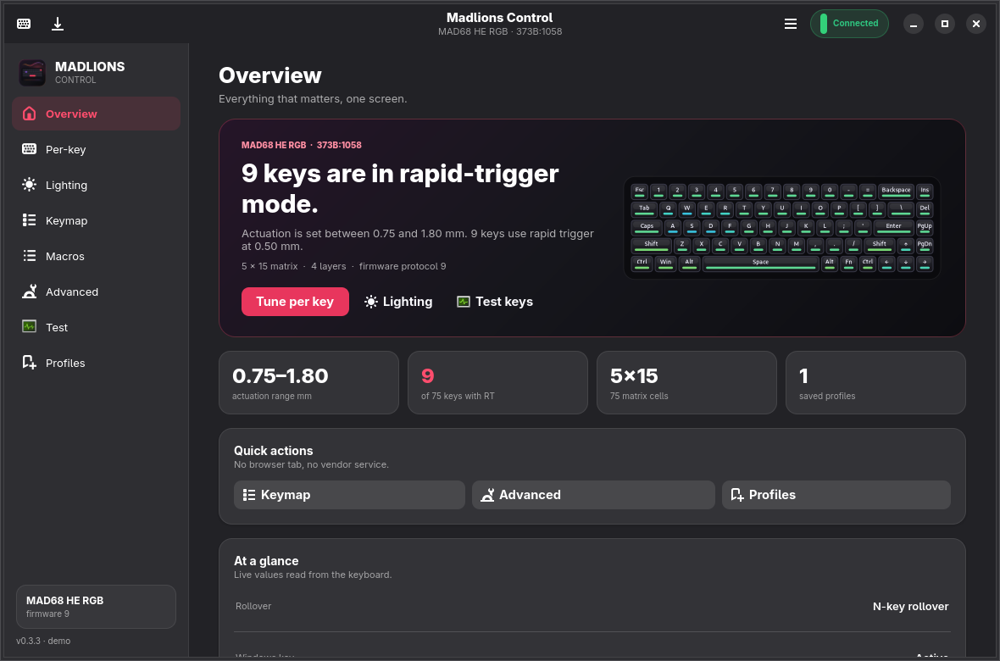
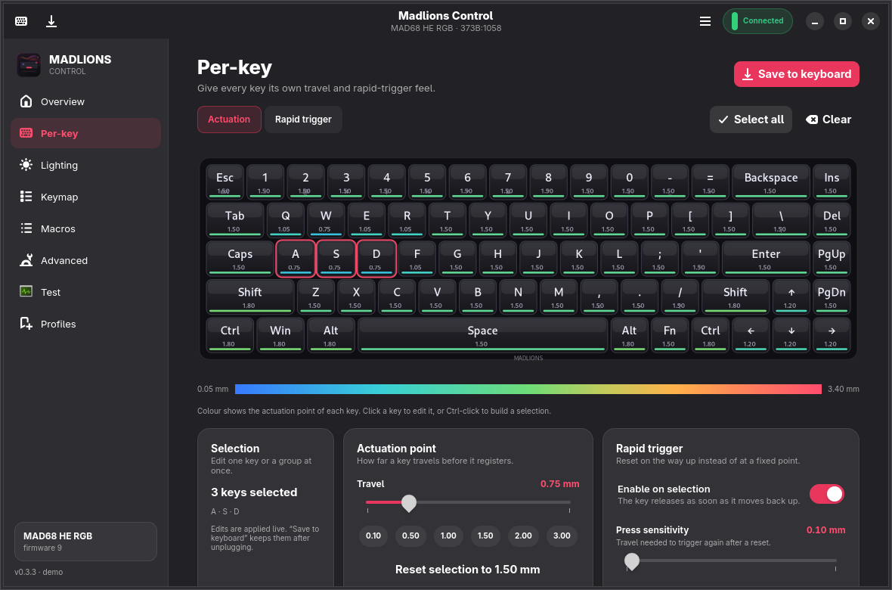

# Madlions Control

<p align="center">
  
</p>

<p align="center">
  <b>Native Linux configuration for MADLIONS magnetic-switch keyboards.</b><br>
  Tune actuation and rapid trigger per key, remap the board, control its lighting,
  and watch live analogue travel — without a browser, an account, or a background
  service.
</p>

<p align="center">
  <a href="https://github.com/NasirA1991/madlions-control/actions/workflows/ci.yml"></a>
  <a href="https://github.com/NasirA1991/madlions-control/releases"></a>
  <a href="https://aur.archlinux.org/packages/madlions-control"></a>
  <a href="https://aur.archlinux.org/packages/madlions-control-git"></a>
  <a href="LICENSE"></a>
</p>



## What it is

Madlions Control is a GTK4 / libadwaita application that configures supported
MADLIONS keyboards directly over their HID interface. The keyboard continues to
work as a normal USB keyboard without the app; the app is only needed when you
want to change how it behaves.

It is built around the feature that makes these boards interesting: adjusting
the feel of every individual key. The reference board is the **MAD68 HE RGB**
(`373B:1058`). The same controller family is used by several 60% and 65% models;
see [Supported keyboards](#supported-keyboards).

## Features

### Per-key key feel

- Set actuation from **0.05 mm to 3.40 mm** in 0.01 mm steps.
- Enable rapid trigger per key, with independent **press** and **release**
  sensitivity.
- Select one key, Ctrl-click several keys, or edit the whole board.
- Read the colour heat map at a glance, use a quick preset, or reset the
  selection to 1.50 mm.
- Changes are applied live; **Save to keyboard** commits actuation and rapid
  trigger to flash.



### Live analogue test

- Per-key travel read from the keyboard's sensor stream.
- Full-board heat map, selected-key gauge, threshold line, and a rolling
  five-second graph.
- Useful for checking a threshold, spotting a noisy switch, or simply seeing
  how your typing is registered.


### Lighting and remapping

- Use the firmware's effects, including breathing, ribbons, rotating belts,
  spectrum, digital rain, and fingertip rainbow.
- Adjust brightness, speed, and colour, including per-key RGB painting and the
  side light strip.
- Edit the board's onboard layers with a searchable keycode picker.
- Build macros from taps, presses, releases, delays, and typed text.
- Configure rapid snappy, SOCD, OKS, hold/click, and dynamic keystroke (DKS)
  bindings.
- Adjust NKRO, Windows-key lock, WASD/arrow swap, macOS layout, game mode,
  bottom-out optimisation, and dead band.


### Profiles, backups, and tools

- Save tuning profiles for different games or typing setups.
- Create a full backup that also captures the keymap, macros, advanced keys,
  hold/click and DKS bindings, and per-key colours.
- Apply the ready-made **Rapid fire**, **Balanced**, and **Typing** presets.
- Reset tuning to the observed baseline on the **MAD68 HE RGB** without touching
  persistent onboard data or per-key colours.
- Open an **Fn shortcut cheatsheet** generated from the layer Fn activates.
- Use the `madlionsctl` command line for scripts, keybinds, and status bars.
- Explore the complete UI without hardware with `--demo`.

No tray daemon, background service, account, or telemetry.

## Supported keyboards

The **MAD68 HE RGB** (`373B:1058`, firmware protocol 9) is the reference board
used for hardware testing. The **MAD60 HE** (`373B:1053`) has write support
enabled from community hardware testing. Other listed boards are recognised but
remain read-only until a device report confirms their firmware and layout.

| Family | USB product IDs |
|---|---|
| MAD68 / FIRE68 / Z68 / MAG68 (65%) | `1057` `1058` `1059` `105A` `10A3` `10A4` `10A7` `10A9` `10AA` `10AB` `10D6` `1123` `1136` `1139` `1144` |
| MAD60 / MAD63 / Z60 / MAD Light 60 (60%) | `1053` `1054` `1055` `1056` `105D` `10AD` `10F6` `110B` `1120` `112A` |
| MAD Smart | `107D` |

If a MADLIONS board exposes the same 32-byte vendor collection but has an
unknown product ID, the app detects it with a generic 5 × 15 layout and opens it
read-only. A [device report](https://github.com/NasirA1991/madlions-control/issues/new?template=device-report.yml)
is the fastest way to add proper support.

Only the MAD68 HE RGB currently has a captured tuning baseline, so **Reset
tuning** is available only on that board. Support is not a promise that every
control works on every model; the app keeps unverified boards read-only by
default.

## Install

### Arch Linux, CachyOS, EndeavourOS

```bash
paru -S madlions-control       # latest tagged release
paru -S madlions-control-git   # latest main
```

Use `yay` in place of `paru` if that is your AUR helper. The packages install
the app, CLI, desktop entry, icons, AppStream metadata, and the udev rule.

### Flatpak, AppImage, or source

Download the latest release from the
[releases page](https://github.com/NasirA1991/madlions-control/releases), or
build from source.

**Flatpak** uses the GNOME runtime and is the most self-contained option:

```bash
flatpak install --user ./madlions-control-*-x86_64.flatpak
flatpak run io.github.madlionscontrol.MadlionsControl
```

**AppImage** uses the host's Python and GTK stack:

```bash
chmod +x madlions-control-*-x86_64.AppImage
./madlions-control-*-x86_64.AppImage
```

**From source:**

```bash
git clone https://github.com/NasirA1991/madlions-control.git
cd madlions-control
./madlions-control --demo      # try it without hardware
sudo ./install.sh              # /usr; installs the udev rule and desktop entry
# or: ./install.sh --user      # ~/.local; no root, no udev rule
```

AppImage, Flatpak, and a `--user` source install need the udev rule installed
separately before the app can write to the keyboard. The AUR and system source
installs add it for you. See [Installation](docs/INSTALLATION.md) for dependency
lists, permissions, update instructions, and uninstall steps.

**CLI availability:** `madlionsctl` is included in the AUR and source installs.
The Flatpak and AppImage provide the GUI only.

## Using it

The main window has eight pages:

| Page | What it is for |
|---|---|
| **Overview** | Keyboard state, tuning summary, and quick actions. |
| **Per-key** | Actuation and rapid-trigger editing on the board. |
| **Lighting** | Effects, brightness, speed, colours, per-key paint, and side light. |
| **Keymap** | The board's layers and the searchable keycode picker. |
| **Macros** | The board's macro slots and the sequence editor. |
| **Advanced** | Switches, dead band, game mode, and smart-key bindings. |
| **Test** | Live travel values and the analogue graph. |
| **Profiles** | Tuning profiles, presets, backups, import/export, and reset. |

Use the keyboard icon in the header for **Fn shortcuts**, or open the main menu
for refresh, reset, diagnostics, permissions, appearance, and About. See
[Using Madlions Control](docs/USAGE.md) for the full walkthrough.

### Saving changes

- **Actuation and rapid trigger** are applied live without touching flash.
  **Save to keyboard** commits them; the Lighting page also has **Save
  lighting**.
- **Keymap, macros, and advanced-key bindings** are written to onboard memory
  immediately. The app labels these edits.
- **Switches, dead band, game mode, and bottom-out optimisation** apply live but
  are volatile in the current build. **Save to keyboard** does not persist them;
  re-apply them after power-cycling if needed.
- **Profiles** are plain JSON files on your computer. Automatic tuning snapshots
  keep the last ten; full backups include persistent sections and are kept until
  you delete them.

## Documentation

| Document | Contents |
|---|---|
| [Installation](docs/INSTALLATION.md) | Supported methods, dependencies, udev permissions, updates, uninstall. |
| [Using Madlions Control](docs/USAGE.md) | Every page, profiles, backups, and saving rules. |
| [CLI reference](docs/CLI.md) | `madlionsctl` commands, options, and examples. |
| [Troubleshooting](docs/TROUBLESHOOTING.md) | Common device, permission, Flatpak, and desktop issues. |
| [Development](docs/DEVELOPMENT.md) | Architecture, tests, screenshots, packaging, and releases. |
| [Protocol notes](docs/PROTOCOL.md) | The verified vendor HID command set. |
| [Contributing](CONTRIBUTING.md) | Device reports, code contributions, and test expectations. |
| [Changelog](CHANGELOG.md) | Release history. |
| [Security policy](SECURITY.md) | Private vulnerability reporting. |

## Limitations and safety

- **Linux only.** The app requires a kernel with `hidraw` support; the Flatpak
  and AppImage builds do not change that.
- **One board is hardware-tested.** The MAD68 HE RGB is the reference. The MAD60
  HE has community write testing; other boards stay read-only by default.
- **No firmware update, DFU, or Hall-sensor calibration.** A bad calibration can
  make a magnetic board feel wrong, so those operations are left to the official
  tool. There is also no factory reset because no verified reset command exists.
- **No onboard profile slots or report-rate control.** Profiles live on the
  computer. The current tuning can be saved to the keyboard, but the app does not
  manage the keyboard's own profile slots.
- **No cloud features, accounts, or telemetry.** Device access is local, and the
  app does not make network requests.
- **Flatpak uses `--device=all`.** Flatpak cannot yet restrict access to one
  `/dev/hidraw` node. The app only opens the vendor HID collection, but this is a
  real sandbox trade-off.
- **Back up before experimenting.** Profiles and full backups are your recovery
  path; keep a copy before changing persistent bindings.

Madlions Control is an independent community project. It is not affiliated with
MADLIONS, FGG, or Shenzhen Yizhita.

## Troubleshooting

- **Keyboard not found:** run `madlionsctl scan` (AUR/source) or open the app's
  Permissions dialog. Use a direct USB port instead of a hub or KVM, and unplug
  and replug the keyboard.
- **Permission denied / read-only:** install the udev rule and replug. The rule
  is in [Installation](docs/INSTALLATION.md#permissions).
- **Board shown as read-only:** that model has not been verified yet. Open a
  device report if you want it supported.
- **Changes disappear after unplugging:** use **Save to keyboard** for actuation
  and rapid trigger. Advanced switches and dead-band settings are volatile.
- **Multiple keyboards connected:** the GUI warns and uses the first detected
  board; the CLI can select one with `--device`.

See [Troubleshooting](docs/TROUBLESHOOTING.md) for the full list, including
Flatpak device access, lighting colour differences, and the KDE window-resize
workaround.

## Performance

Measured on the reference MAD68 HE RGB under Xvfb:

- Window ready in about **0.4 s**.
- **0–0.2% CPU** idle; about **0.5–1%** with the Test page open but no key
  moving.
- The Test page redraws at **60 fps** and uses roughly **50% of one core** while
  the heat map is actively moving. That is the deliberate smoothness trade-off;
  repainting stops while every key is idle.
- About **150 MB PSS** idle, or **170 MB** with the Test page open (GTK4 and
  Python shared libraries included).
- AppImage is about **1.1 MB**; the Flatpak app payload is about **0.2 MB**.
- No daemon and no background service.

Memory is the one area where this is a normal GTK/Python application rather than
a tiny native utility; CPU and disk use are small, and the app is only resident
while open.

## Contributing and device reports

Device reports are the most useful contribution. Run `madlionsctl report`
(AUR/source), review the read-only JSON, and open a
[device report](https://github.com/NasirA1991/madlions-control/issues/new?template=device-report.yml).
`madlionsctl report` redacts the USB serial by default; pass `--serial` only if
you deliberately want to include it.

Code contributions should keep the write gate, volatile-first tuning, and
explicit persistence rules intact. See [CONTRIBUTING.md](CONTRIBUTING.md) and
[Development](docs/DEVELOPMENT.md).

## Security

Please report vulnerabilities privately; see [SECURITY.md](SECURITY.md).

## License

MIT. See [LICENSE](LICENSE).
